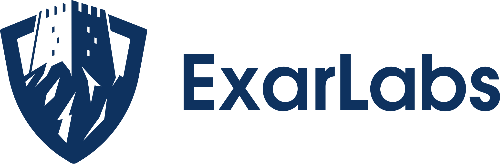

# sales-skills

<a href="https://exarlabs.com"><picture><source media="(prefers-color-scheme: dark)" srcset="assets/exarlabs-logo-white.svg"></picture></a>

**Claude-skill az ExarLabs sales partnereinek.** A saját Claude-od kikeresi a leadjeidet az Exar Sales portálról,
előkészíti a bemutató levelet a legfrissebb sablonból (magyarul magázva vagy tegezve, illetve románul), és
megnyitja az Outlookodban. A Küldést te nyomod meg. Egy hívás után az új céget is felveszi a portálra.

> Verzió 0.1.0, előzetes. A portál használatához ExarLabs sales partner fiók kell.

## Három perc alatt

1. **Letöltés:** a legfrissebb kiadás [`exar-sales.zip`](https://github.com/ExarLabs/sales-skills/releases/latest/download/exar-sales.zip) fájlja.
2. **Telepítés:** claude.ai vagy Claude Desktop: Beállítások, Képességek (Capabilities), Skills, feltöltés. Claude
   Code: `/plugin marketplace add ExarLabs/sales-skills`, majd `/plugin install exar-sales@sales-skills`.
   Részletek: [docs/telepites.md](docs/telepites.md).
3. **Bekötés:** lépj be a `https://sales.exarlabs.com/sales/leads` oldalon, és mondd a Claude-nak: „Kösd be az Exar
   Sales-t.” Végigvezet. Leírás: [docs/bekotes.md](docs/bekotes.md).

Utána így használod:

| Mondd ezt | Ezt kapod |
|---|---|
| „Milyen leadjeim vannak?” | a saját leadjeid listája |
| „Küldd ki az ExarLabs bemutatóját a Példa Kft.-nek, csütörtök 10 vagy péntek 14.” | kitöltött levél az Outlookodban, küldésre készen |
| „Most beszéltem a Minta SRL-lel, vedd fel.” | az adatok összeszedése, visszaolvasás, felvétel a portálra |

## Hol mi van

| Mit keresel | Hol |
|---|---|
| A skill | [skills/exar-sales/SKILL.md](skills/exar-sales/SKILL.md) |
| A levélsablonok (magyar magázó, magyar tegező, román) | [skills/exar-sales/sablonok/](skills/exar-sales/sablonok/) |
| Hogyan választ sablont, hogyan tölti ki | [skills/exar-sales/references/bemutato.md](skills/exar-sales/references/bemutato.md) |
| Hogyan megy ki a levél | [docs/kuldes.md](docs/kuldes.md) |
| A CRM (portál) bekötése | [docs/bekotes.md](docs/bekotes.md) |
| A program (Claude Code, Desktop) | [skills/exar-sales/exar_sales.py](skills/exar-sales/exar_sales.py) |

A sablonokat a skill minden levélnél innen olvassa, ezért egy javítás a repóban azonnal minden partnernél érvényes;
újratelepíteni csak akkor kell, ha a skill maga változik.

## Biztonság

- Levelet a skill soha nem küld el: a Küldés a partneré.
- A portál csak a partner saját leadjeit adja; a CRM többi része nem érhető el.
- Kulcs, jelszó nem kerül a beszélgetésbe és nem kerül a repóba. A repó nyilvános: belső adat nem lehet benne; a
  `scripts/tiltolista.py` ezt minden commitnál ellenőrzi.

## Fejlesztés

```
sh scripts/ellenorzes.sh          # tesztek és tiltólista
python3 scripts/csomagol.py       # dist/exar-sales.zip
gh release create v0.1.0 dist/exar-sales.zip  # kiadás: a letölthető zip
```

## Licenc

MIT, lásd [LICENSE](LICENSE).

## Az ExarLabsről

Ezt a projektet az [ExarLabs](https://exarlabs.com) készíti és tartja karban, Székelyudvarhelyről.

**Továbbiak az ExarLabstől**

- [atomic-skills](https://github.com/ExarLabs/atomic-skills): Claude Code skillek az Atomi ügyfeleinek.
- [paros-advisor](https://github.com/ExarLabs/paros-advisor): tanácsadó, amely a saját jegyzetmappádból személyes rendszert épít.
